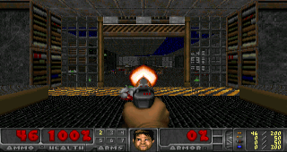
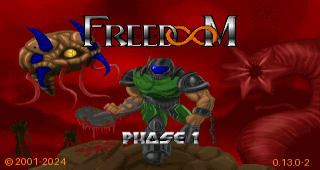

# czdoom — Doom on the M5Stack CardputerZero

Doom for the [CardputerZero](https://github.com/CardputerZero) (Raspberry Pi CM0, 320×170 screen, 46-key keyboard). It installs as a normal `.deb`, shows up in the stock launcher as **DOOM**, and plays Doom, Doom II and Freedoom WADs.

 

*Screenshots are from the off-device test, at the panel's exact resolution and pixel format.*

It is a small platform backend ([src/doomgeneric_cardputerzero.c](src/doomgeneric_cardputerzero.c)) for [doomgeneric](https://github.com/ozkl/doomgeneric):

- **Video** goes straight to the panel's framebuffer (`/dev/fb_lcd`). Doom renders at 320×200 and each frame is blended down to 320×170, so status bar numbers and menu text stay readable.
- **Input** is read from the built-in keyboard through evdev. The game is played on the letter keys, because the arrow keys on this keyboard need Fn held down. A USB keyboard works too.
- **Sound** uses SDL2_mixer for effects and MIDI music.

> **Status:** the build and an automated off-device test (fake framebuffer plus scripted key presses) pass. It has not been run on real CardputerZero hardware yet — please [open an issue](https://github.com/droomurray/czdoom/issues) with `/tmp/czdoom.log` if something is off.

## Install

Download `czdoom_0.1.0_arm64.deb` from the [Releases page](https://github.com/droomurray/czdoom/releases), copy it to the device and install it with `apt`, which also pulls in SDL2, the free Freedoom game data and a small soundfont for music (about 25 MB, so the device needs internet):

```sh
scp czdoom_0.1.0_arm64.deb pi@<device-ip>:/tmp/
ssh pi@<device-ip> 'sudo apt update && sudo apt install -y /tmp/czdoom_0.1.0_arm64.deb'
```

No SSH? Get the `.deb` onto the device any other way (a web file manager, a USB stick), then run the `apt install` line in the launcher's terminal with the path where the file landed, for example `sudo apt install -y ~/czdoom_0.1.0_arm64.deb`.

**DOOM** appears in the launcher within a few seconds. To remove it: `sudo apt remove czdoom`.

### Playing the original Doom

Freedoom is installed by default so the game works out of the box. To play the original games, copy your own WAD into `~/doom` on the device; it is picked up automatically and preferred over Freedoom:

```sh
scp doom1.wad pi@<device-ip>:doom/
```

Recognised names, in order of preference: `doom2.wad`, `plutonia.wad`, `tnt.wad`, `doom.wad`, `doom1.wad` (shareware), then `freedoom2.wad`, `freedoom1.wad`.

## Controls

| Key | Action |
| --- | --- |
| `W` / `S` | Forward / back (also menu up / down) |
| `A` / `D` | Turn left / right |
| `Q` / `E` | Strafe left / right |
| `K` or `Ctrl` | Fire |
| `L` or `Space` | Use / open doors |
| `1`–`7` | Select weapon |
| `Shift` | Walk (running is the default) |
| `Tab` | Automap |
| `Enter` | Select in menus |
| `Esc` | Menu / back |
| `Y` / `N` | Answer prompts |
| `Alt` + letter | Type the letter itself — for cheat codes and save names |
| `Fn` + `F` `Z` `X` `C` | Arrow keys, which also work |
| `Fn` + `1`–`0` | F1–F10 (F2 save, F3 load, F6 quicksave, F9 quickload…) |

To quit, use **Quit Game** in the menu, or hold the launcher's Home key for 5 seconds.

Cheat codes use letters that are also movement keys, so hold `Alt` while typing them (for example `Alt`+`i d d q d`).

## Settings

Saves and `default.cfg` live in `~/.local/share/czdoom`. The launcher script reads a few environment variables:

| Variable | Effect |
| --- | --- |
| `CZDOOM_WAD=/path/file.wad` | Play a specific WAD |
| `CZDOOM_ASPECT=4:3` | Keep Doom's 4:3 shape (226×170, black bars) instead of filling the screen |
| `CZDOOM_ARGS="-nomusic"` | Extra engine arguments (`-nosound`, `-warp 1 3`, `-skill 4`, `-file mod.wad`…) |
| `CZDOOM_NO_AUTORUN=1` | Walk by default, `Shift` to run |
| `CZDOOM_FB=/dev/fb0` | Use a different framebuffer, e.g. HDMI |
| `CZDOOM_KBD=/dev/input/eventN` | Use only this keyboard |

From an SSH session you can start it directly: `/usr/share/APPLaunch/bin/czdoom`.

## Build

You need Docker; nothing else. The build runs natively on an arm64 host and cross-compiles on x86, so it works anywhere without emulation:

```sh
./build.sh                                   # -> dist/czdoom_0.1.0_arm64.deb
DOCKER_HOST=ssh://user@host ./build.sh       # same, on a remote Docker host
```

Or build on the CardputerZero itself:

```sh
sudo apt install -y build-essential git pkg-config libsdl2-dev libsdl2-mixer-dev
make deb
sudo apt install -y ./dist/czdoom_0.1.0_arm64.deb
```

`make NOSOUND=1 deb` builds a silent version with no SDL2 dependency.

### Test without a device

```sh
docker build --target smoke-out --output type=local,dest=out .
```

This runs the game against a plain file standing in for the 320×170 RGB565 panel and a file of raw key events standing in for the keyboard, checks that the picture is drawn and that the keys turn the view and fire the weapon, and writes screenshots to `out/`.

## Troubleshooting

- **Nothing happens when launching** — read `/tmp/czdoom.log`. The usual causes are no WAD (`sudo apt install freedoom`) or a user that is not in the `video` and `input` groups.
- **No music, effects work** — install a soundfont: `sudo apt install timgm6mb-soundfont`.
- **Too slow or crackling audio** — start with `CZDOOM_ARGS="-nomusic"`; MIDI synthesis is the most expensive part.

## How it fits the device

| | |
| --- | --- |
| Display | ST7789V3, 320×170 RGB565, exposed as `/dev/fb_lcd` by the stock image |
| Keyboard | TCA8418, evdev at `/dev/input/by-path/platform-3f804000.i2c-event`; Fn layers are handled in the kernel driver |
| Launcher | APPLaunch scans `/usr/share/APPLaunch/applications/*.desktop` and runs `Exec` as the logged-in user |
| Installed files | `/usr/share/APPLaunch/apps/czdoom/czdoom`, `/usr/share/APPLaunch/bin/czdoom`, `…/applications/czdoom.desktop`, `…/share/images/czdoom.png` |

## License

GPL-2.0-or-later, like the Doom source and doomgeneric it builds on — see [LICENSE](LICENSE). The engine is fetched at a pinned commit during the build and is not copied into this repository. No game data is included: Freedoom is installed from Debian, and the original Doom WADs are yours to supply.
